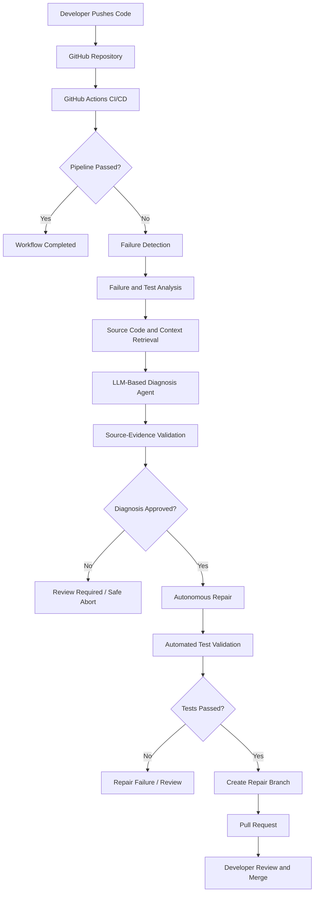

 
# Multi-Agent MCP Framework for Autonomous CI/CD Failure Diagnosis and Repair

An intelligent multi-agent framework that detects CI/CD pipeline failures, investigates their root causes, recommends code corrections, and performs controlled autonomous repair using Large Language Models (LLMs), Model Context Protocol (MCP), GitHub Actions, and automated testing.

---

## 1. Project Overview

Modern software development relies on Continuous Integration and Continuous Deployment (CI/CD) pipelines to maintain code quality and automate software delivery. However, pipeline failures often require developers to manually inspect logs, identify faulty code, determine root causes, implement corrections, and rerun tests.

This project proposes a **Multi-Agent MCP Framework for Autonomous CI/CD Failure Diagnosis and Repair** that automates significant parts of this process.

The framework uses specialized AI agents to analyze CI/CD failures, retrieve relevant source code and test information, generate root-cause diagnoses, validate proposed fixes, and execute controlled repair operations.

The system follows a guarded autonomous repair approach in which AI-generated recommendations are checked against deterministic source-code evidence before a repair is allowed to proceed.

## 2. Project Objectives

The major objectives are:

- Automatically detect failed CI/CD pipeline executions.
- Retrieve relevant GitHub Actions logs and failure information.
- Identify failed test cases and their corresponding source-code locations.
- Use LLM-based agents to analyze failures and identify probable root causes.
- Retrieve historical source-code information for accurate diagnosis.
- Validate AI-generated diagnoses using deterministic evidence checks.
- Generate and apply targeted code corrections.
- Execute automated tests to validate proposed repairs.
- Create separate repair branches and support pull-request-based integration.
- Reduce manual debugging effort while maintaining safety and traceability.

## 3. Proposed System Architecture

The framework follows a multi-agent architecture in which different agents perform specialized tasks and communicate through a coordinated workflow.

### Major Components

| Component | Responsibility |
|---|---|
| Orchestrator Agent | Coordinates the overall diagnosis and repair workflow. |
| CI/CD Monitoring | Identifies failed GitHub Actions workflow executions. |
| Failure Analysis | Extracts relevant test failures and execution details. |
| Context Retrieval | Retrieves relevant source code, test cases, and historical implementation information. |
| Diagnosis Agent | Uses an LLM to identify root causes and recommend corrections. |
| Source-Evidence Gate | Validates diagnosis and recommended fixes against deterministic source-code evidence. |
| Repair Agent | Applies approved code corrections in an isolated repair workflow. |
| Validation Agent | Executes tests to verify whether the repair resolves the failure. |
| GitHub Integration | Supports repair branches and pull-request-based code integration. |

### System Workflow



## 4. Multi-Agent Framework

### 4.1 Orchestrator Agent

The Orchestrator Agent acts as the central controller of the framework.

Its responsibilities include:

- Initiating the failure diagnosis workflow.
- Coordinating the specialized agents.
- Passing failure information between components.
- Managing diagnosis and repair stages.
- Enforcing safety checks before autonomous repair.
- Tracking repair and validation outcomes.

### 4.2 Diagnosis Agent

The Diagnosis Agent analyzes the failed test cases and relevant source-code information.

It uses an LLM to:

- Understand the failure description.
- Analyze expected and actual test results.
- Identify the potentially faulty function.
- Determine the probable root cause.
- Generate a recommended code correction.
- Return structured diagnosis information.

The diagnosis is not automatically trusted. Its output must pass the source-evidence validation stage.

### 4.3 Context Retrieval

The context retrieval component gathers relevant information required for diagnosis, including:

- Failed test information.
- Test source code.
- Implementation source code.
- Relevant function definitions.
- Historical source-code information.

This context helps the diagnosis agent reason about the failure using the actual implementation rather than relying only on error messages.

### 4.4 Source-Evidence Validation

The Source-Evidence Gate is a deterministic validation layer that checks whether an AI-generated diagnosis is sufficiently supported by the available source code and test context.

Its checks include:

- Matching the diagnosed test with an authoritative failure context.
- Verifying the target source file and function.
- Inspecting the implementation using Python AST-based analysis.
- Checking supported arithmetic operations against their documented contracts.
- Comparing the computed result with the reported actual result.
- Checking whether the recommended correction is supported by the source evidence.

The current arithmetic contracts cover:

| Function | Expected operation | Incorrect operations |
|---|---|---|
| `add` | `a + b` | Subtraction, multiplication, division |
| `subtract` | `a - b` | Addition, multiplication, division |
| `multiply` | `a * b` | Addition, subtraction, division |
| `divide` | `a / b` | Addition, subtraction, multiplication |

The gate uses two important outcomes:

- **READY_FOR_VALIDATION:** The diagnosis satisfies the configured evidence checks and can proceed to the next validation stage.
- **REVIEW_REQUIRED:** The available evidence is insufficient or does not satisfy the validation conditions. Autonomous repair is safely stopped.

This mechanism reduces the risk of applying unsupported or incorrect AI-generated changes.

### 4.5 Autonomous Repair

After a diagnosis passes the required safety checks, the repair workflow can:

- Identify the target source-code location.
- Apply the recommended correction.
- Isolate changes in a dedicated repair branch.
- Execute the relevant validation process.
- Report the repair outcome.

The repair process is designed to avoid modifying the main branch directly.

### 4.6 Validation and GitHub Integration

The validation stage checks whether the proposed correction resolves the original failure.

When the repair workflow succeeds, the system supports:

- Repair branch creation.
- Automated test execution.
- Repair result reporting.
- Pull request creation.
- Developer review and controlled merging.

A successful repair is not equivalent to an automatically merged change. The pull-request workflow preserves the opportunity for human review.

## 5. Technology Stack

| Technology | Purpose |
|---|---|
| Python 3.12 | Core framework implementation |
| Model Context Protocol (MCP) | Structured communication and tool integration |
| Large Language Models (LLMs) | Failure analysis and root-cause diagnosis |
| GitHub | Source-code management and collaboration |
| GitHub Actions | CI/CD workflow execution |
| Pytest | Automated testing and validation |
| Python AST | Deterministic source-code inspection |
| Git | Version control and repair branch management |

## 6. Project Directory Structure

The main project components are organized as follows:

```text
mcp-devops-research/
│
├── agents/
│   ├── diagnosis_agent.py
│   └── ...
│
├── app/
│   └── calculator.py
│
├── tests/
│   ├── test_project.py
│   ├── test_source_evidence_gate.py
│   ├── test_normalize_test_name.py
│   ├── test_llm_json_extraction.py
│   └── ...
│
├── .github/
│   └── workflows/
│       └── ...
│
├── README.md
├── requirements.txt
├── .gitignore
└── ...
```

*Note: The structure above highlights the principal project components. Additional files and modules may be present in the repository.*

## 7. Installation and Setup

### Prerequisites

Install the following before running the project:

- Python 3.12
- Git
- GitHub account
- Access to the configured LLM provider
- Required MCP tools and integrations

### Step 1: Clone the Repository

```bash
git clone https://github.com/gagneshkakkar/mcp-devops-research.git
```

### Step 2: Navigate to the Project

```bash
cd mcp-devops-research
```

### Step 3: Create a Virtual Environment

Windows:

```powershell
python -m venv .venv
```

### Step 4: Activate the Virtual Environment

```powershell
.venv\Scripts\Activate.ps1
```

### Step 5: Install Dependencies

```powershell
python -m pip install --upgrade pip
pip install -r requirements.txt
```

### Step 6: Configure Environment Variables

Configure the credentials and settings required by the selected LLM provider and external integrations.

Store sensitive information in environment variables or an appropriate secrets manager.

Do not commit API keys, access tokens, or other credentials to the repository.

## 8. Running the Project

The framework can be executed through its configured orchestration entry point.

For the local test suite, use:

```powershell
python -m pytest -q
```

To execute a specific test module:

```powershell
python -m pytest tests/test_project.py -v
```

To test the source-evidence validation component:

```powershell
python -m pytest tests/test_source_evidence_gate.py -q
```

To test diagnosis-related functionality:

```powershell
python -m pytest tests/test_normalize_test_name.py tests/test_llm_json_extraction.py -q
```

The exact orchestration command and required environment configuration should follow the current project entry point.

## 9. Example Failure Scenario

Consider a calculator application containing the following implementation:

```python
def add(a: float, b: float) -> float:
    """Return the sum of two numbers."""
    return a * b
```

The corresponding test is:

```python
def test_add():
    assert add(2, 3) == 5
```

### Failure Analysis

The test expects:

```text
Expected: 5
Actual:   6
```

The diagnosis agent identifies that the `add()` function uses multiplication instead of addition.

The recommended correction is:

```python
def add(a: float, b: float) -> float:
    """Return the sum of two numbers."""
    return a + b
```

The source-evidence gate checks the documented operation, implementation operator, test context, computed result, and recommended correction.

If the evidence checks pass, the diagnosis can proceed to the next validation stage. Otherwise, the workflow requires review and stops autonomous repair.

## 10. Testing and Evaluation

The framework uses automated tests to evaluate its components and verify repair outcomes.

The major testing areas include:

1. **Diagnosis Testing:** Evaluates the identification of failed tests and root causes.
2. **Context Retrieval Testing:** Checks the retrieval of relevant source-code and test information.
3. **Source-Evidence Testing:** Validates deterministic diagnosis checks.
4. **JSON Extraction Testing:** Tests the extraction and parsing of structured LLM responses.
5. **Test Name Normalization:** Checks the mapping of LLM-provided test names to authoritative pytest node IDs.
6. **Repair Validation:** Checks whether proposed corrections resolve the original test failure.
7. **Integration Testing:** Evaluates interactions between the framework components.

The test suite can be executed using:

```powershell
python -m pytest -q
```

## 11. Safety and Reliability Considerations

The framework incorporates several safeguards:

- AI-generated diagnoses are treated as recommendations rather than unquestioned facts.
- Source-code and test evidence are checked before repair.
- Unsupported diagnoses are marked for review.
- Repair operations are isolated from the main development branch.
- Automated testing is used to evaluate proposed corrections.
- Pull requests support human review before changes are merged.
- Sensitive credentials should be managed outside source control.

These safeguards help maintain control over autonomous code modification.

## 12. Current Implementation Status

The project has progressed beyond the initial framework design.

The following capabilities have been implemented and tested during development:

- Multi-agent orchestration workflow.
- LLM-based failure diagnosis.
- Structured JSON extraction from LLM responses.
- Diagnosis test-name normalization.
- Historical source-code retrieval and inspection.
- Deterministic source-evidence validation.
- Arithmetic contract validation for addition, subtraction, multiplication, and division.
- Automated pytest-based validation.
- Autonomous repair workflow.
- GitHub repair branch and pull-request integration.

Individual capabilities should be evaluated through their corresponding tests and end-to-end workflow runs.

## 13. Limitations

The current framework has several limitations and areas requiring further development:

- Diagnosis quality depends on the accuracy and availability of retrieved context.
- LLM-generated recommendations may require additional validation.
- Deterministic evidence checks currently support configured source patterns and contracts rather than every possible programming construct.
- Complex multi-file failures may require more advanced dependency and impact analysis.
- Some failures may need human intervention when sufficient evidence is unavailable.
- Autonomous repair effectiveness depends on successful integration with the CI/CD environment and external tools.

## 14. Future Enhancements

Potential future improvements include:

- Support for multiple programming languages.
- More advanced semantic code analysis.
- Improved retrieval-augmented generation (RAG) for historical debugging context.
- Enhanced coordination between specialized agents.
- Dependency-aware multi-file repair.
- More comprehensive failure classification.
- Automated regression analysis.
- Repair confidence scoring supported by measurable evidence.
- Integration with additional CI/CD platforms.
- Improved monitoring, reporting, and repair analytics.
- More extensive evaluation across real-world software repositories.

## 15. Conclusion

The Multi-Agent MCP Framework for Autonomous CI/CD Failure Diagnosis and Repair aims to make software debugging and maintenance more efficient through coordinated AI agents and controlled automation.

By combining LLM-based diagnosis, source-code context retrieval, deterministic evidence validation, automated testing, and GitHub integration, the framework provides a structured approach to identifying and resolving CI/CD failures.

Its guarded repair architecture ensures that autonomous modifications are supported by evidence and validated before they are proposed for integration.

The project demonstrates how multi-agent systems and MCP-based tool integration can contribute to intelligent, reliable, and more autonomous DevOps workflows.

---

## 16. Repository

**GitHub Repository:**  
https://github.com/gagneshkakkar/mcp-devops-research

**Project Title:**  
Multi-Agent MCP Framework for Autonomous CI/CD Failure Diagnosis and Repair
